# JSON-Relational Duality Views + ORDS — One JSON Document, Four Tables, Zero Handler Code

[](LICENSE)


> JSON-Relational Duality Views turn four order tables into one JSON document, and one ORDS call publishes it as a full REST API: GET, POST, PUT and DELETE with built-in ETag lost-update protection and no handler code.

<p align="center">
  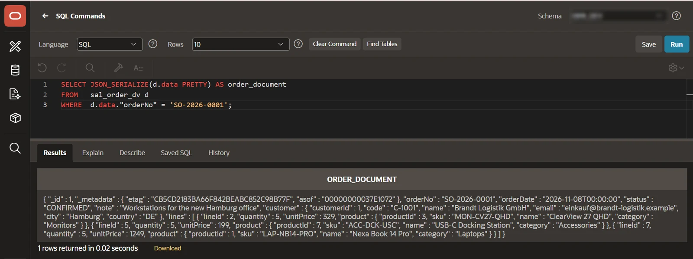
</p>

**By Hassaan Ahmed Tahir — Senior Oracle APEX Developer · [Read the full tutorial](https://apexwithhassaan.vercel.app/blog/duality-views-ords)**

---

## 📁 Repository structure

```
apex-ords-json-duality-views/
src/01_create_tables.sql          # customers, orders and order lines tables
src/02_sample_data.sql            # sample customers and orders
src/03_create_duality_view.sql    # SAL_ORDER_DV JSON-relational duality view
src/04_publish_with_ords.sql      # enable the schema and the view for REST
examples/post_order.json          # example POST body — a complete order
examples/put_order.json           # example PUT body — update, delete and insert lines
docs/images/                      # screenshots from the blog post
CHANGELOG.md
LICENSE                           # MIT
README.md
```

> 💡 Every file above contains the exact code from the tutorial below, ready to copy or run.

---

A sales order is never one row. It's a header, a customer, and a list of order lines — each pointing to a product. Store it relationally and every REST API for it turns into plumbing: join four tables for GET, split the JSON back into rows for POST, and for PUT work out which lines were changed, which were removed and which are new.

In my [ORDS CRUD post](https://apexwithhassaan.vercel.app/blog/ords-crud-rest-api) I wrote every one of those handlers by hand. This time Oracle does it for me. With **JSON-Relational Duality Views** — new in Oracle Database 23ai — one view turns *four tables into one JSON document*, and **one ORDS call** turns that view into a complete REST API: GET, POST, PUT, DELETE and built-in protection against lost updates.

> ✅ **What you'll have at the end:** an `/orders/` REST API where one `POST` creates an order with all its lines, one `PUT` updates, deletes and inserts lines at the same time, and a stale save from a second user is rejected with `412 Precondition Failed` — without a single line of handler code.

> 🧪 **Tested end to end on:** Oracle AI Database 26ai (`23.26.1`), ORDS `26.1.1` and Oracle APEX 26.1 — in SQL Commands, the browser and Postman. Every figure in this post is the real result.

## 📑 Table of Contents

1. [What Is a JSON-Relational Duality View?](#what)
2. [Why Not Just Write REST Handlers?](#why)
3. [The Scenario: Sales Orders](#scenario)
4. [Step 1: Check Your Versions](#s1)
5. [Step 2: Create the Tables](#s2)
6. [Step 3: Create the Duality View](#s3)
7. [Step 4: Prove the "Duality"](#s4)
8. [Step 5: Publish It with ORDS — One Call](#s5)
9. [Step 6: POST a Complete Order](#s6)
10. [Step 7: PUT — Update, Delete and Insert Lines in One Call](#s7)
11. [Step 8: ETag — Lost-Update Protection for Free](#s8)
12. [Step 9: DELETE the Order](#s9)
13. [Gotchas That Cost Me Time](#gotchas)
14. [Production Checklist](#checklist)
15. [Wrap-Up](#wrap)

<a id="what"></a>

## 1. What Is a JSON-Relational Duality View?

A **JSON-Relational Duality View** is a view that presents relational rows as JSON documents — and, unlike an ordinary view, it is **fully updatable** as JSON. Read it, and Oracle assembles the document from the tables. Write a document into it, and Oracle splits it back into inserts, updates and deletes on the right tables.

The data is stored **only once**, in normal tables. There's no JSON copy and no sync job: the same data is relational *and* JSON at the same time — hence "duality".

1. 🗄️ **4 tables** — customers · products · orders · lines
2. 🔀 **Duality View** — defines the document shape and what may change
3. 📄 **1 JSON document** — per order — read and write
4. 🌐 **ORDS AutoREST** — GET · POST · PUT · DELETE

<a id="why"></a>

## 2. Why Not Just Write REST Handlers?

|  | Custom ORDS handlers | Duality View + AutoREST |
|---|---|---|
| GET one order with lines | Join 4 tables, build JSON with `JSON_OBJECT` / `JSON_ARRAYAGG` | Automatic |
| POST order + lines | Parse JSON, insert header, loop lines, set foreign keys | Automatic, one call |
| PUT changed lines | Diff incoming lines against the table: update, delete, insert | Automatic — Oracle works out the difference |
| Two users editing | Version column or `SELECT … FOR UPDATE` logic | Built-in **ETag** → `412` |
| What may be changed | Checks in your PL/SQL | Declared in the view: `WITH INSERT UPDATE DELETE` / `NOUPDATE` |
| Code to maintain | A module, templates and several handlers | One view and one `ENABLE_OBJECT` call |

Custom handlers still win when an endpoint needs real business logic (soft deletes, workflow calls, special responses). For document-shaped data — an order, an invoice, a vehicle with its equipment — Duality Views remove almost all of the plumbing.

<a id="scenario"></a>

## 3. The Scenario: Sales Orders

A small sales-order system for an IT-hardware distributor. Four tables, one document:

| Table | Holds | In the JSON document |
|---|---|---|
| `SAL_ORDERS` | Order header: number, date, status, note | The **root** — editable |
| `SAL_ORDER_LINES` | Product, quantity and price per order | The `lines` array — editable (insert, update, delete) |
| `SAL_CUSTOMERS` | Business customers | The `customer` object — **read-only** |
| `SAL_PRODUCTS` | The product catalog | The `product` object in each line — **read-only** |

The key design idea: an order document *shows* the customer and product details, but it only *owns* the order and its lines. Renaming a customer through an order must be impossible — and the database will enforce that for us.

<a id="s1"></a>

## 4. Step 1: Check Your Versions

Duality Views need Oracle Database 23ai or later, and publishing them needs a current ORDS. Three quick checks in **SQL Workshop → SQL Commands**:

```sql
SELECT version_full FROM product_component_version;
```

```sql
SELECT ords.installed_version FROM dual;
```

```sql
SELECT view_name FROM user_json_duality_views;
```

| Check | My result |
|---|---|
| Database | `23.26.1.0.0` — Oracle AI Database 26ai |
| ORDS | `26.1.1.r1321130` |
| Duality views | *no data found* — the dictionary view exists, no views yet |

> ℹ️ If check 3 fails with *table or view does not exist*, your database is older than 23ai and Duality Views aren't available.

<a id="s2"></a>

## 5. Step 2: Create the Tables

Run this in **SQL Workshop → SQL Scripts**. Every table has its own primary key — a Duality View needs one per table, because every JSON object must map to exactly one identifiable row.

```sql
CREATE TABLE sal_customers (
  cust_id       NUMBER GENERATED BY DEFAULT AS IDENTITY,
  cust_code     VARCHAR2(20)  NOT NULL,
  cust_name     VARCHAR2(200) NOT NULL,
  cust_email    VARCHAR2(200),
  cust_city     VARCHAR2(100),
  cust_country  VARCHAR2(2),
  CONSTRAINT sal_customers_pk      PRIMARY KEY (cust_id),
  CONSTRAINT sal_customers_code_uk UNIQUE (cust_code)
);

CREATE TABLE sal_products (
  prod_id          NUMBER GENERATED BY DEFAULT AS IDENTITY,
  prod_sku         VARCHAR2(40)  NOT NULL,
  prod_name        VARCHAR2(200) NOT NULL,
  prod_category    VARCHAR2(100) NOT NULL,
  prod_unit_price  NUMBER(12,2)  NOT NULL,
  prod_active_yn   VARCHAR2(1)   DEFAULT 'Y' NOT NULL,
  CONSTRAINT sal_products_pk        PRIMARY KEY (prod_id),
  CONSTRAINT sal_products_sku_uk    UNIQUE (prod_sku),
  CONSTRAINT sal_products_price_ck  CHECK (prod_unit_price >= 0),
  CONSTRAINT sal_products_active_ck CHECK (prod_active_yn IN ('Y','N'))
);
```

```sql
CREATE TABLE sal_orders (
  ordr_id       NUMBER GENERATED BY DEFAULT AS IDENTITY,
  ordr_no       VARCHAR2(20)  NOT NULL,
  ordr_cust_fk  NUMBER        NOT NULL,
  ordr_date     DATE          DEFAULT TRUNC(SYSDATE) NOT NULL,
  ordr_status   VARCHAR2(20)  DEFAULT 'NEW' NOT NULL,
  ordr_note     VARCHAR2(400),
  CONSTRAINT sal_orders_pk      PRIMARY KEY (ordr_id),
  CONSTRAINT sal_orders_no_uk   UNIQUE (ordr_no),
  CONSTRAINT sal_orders_cust_fk FOREIGN KEY (ordr_cust_fk) REFERENCES sal_customers (cust_id),
  CONSTRAINT sal_orders_stat_ck CHECK (ordr_status IN ('NEW','CONFIRMED','SHIPPED','CANCELLED'))
);
CREATE INDEX sal_orders_cust_ix ON sal_orders (ordr_cust_fk);

CREATE TABLE sal_order_lines (
  orli_id          NUMBER GENERATED BY DEFAULT AS IDENTITY,
  orli_ordr_fk     NUMBER       NOT NULL,
  orli_prod_fk     NUMBER       NOT NULL,
  orli_qty         NUMBER(10)   NOT NULL,
  orli_unit_price  NUMBER(12,2) NOT NULL,
  CONSTRAINT sal_order_lines_pk       PRIMARY KEY (orli_id),
  CONSTRAINT sal_order_lines_ordr_fk  FOREIGN KEY (orli_ordr_fk) REFERENCES sal_orders (ordr_id),
  CONSTRAINT sal_order_lines_prod_fk  FOREIGN KEY (orli_prod_fk) REFERENCES sal_products (prod_id),
  CONSTRAINT sal_order_lines_qty_ck   CHECK (orli_qty > 0),
  CONSTRAINT sal_order_lines_price_ck CHECK (orli_unit_price >= 0)
);
CREATE INDEX sal_order_lines_ordr_ix ON sal_order_lines (orli_ordr_fk);
CREATE INDEX sal_order_lines_prod_ix ON sal_order_lines (orli_prod_fk);
```

```sql
INSERT INTO sal_customers (cust_code, cust_name, cust_email, cust_city, cust_country)
VALUES ('C-1001', 'Brandt Logistik GmbH', 'einkauf@brandt-logistik.example', 'Hamburg', 'DE');
INSERT INTO sal_customers (cust_code, cust_name, cust_email, cust_city, cust_country)
VALUES ('C-1002', 'Northbridge Consulting Ltd', 'it@northbridge.example', 'Manchester', 'GB');
INSERT INTO sal_customers (cust_code, cust_name, cust_email, cust_city, cust_country)
VALUES ('C-1003', 'Van Dijk Architecten B.V.', 'office@vandijk.example', 'Utrecht', 'NL');
INSERT INTO sal_customers (cust_code, cust_name, cust_email, cust_city, cust_country)
VALUES ('C-1004', 'Alpine Medical AG', 'procurement@alpinemedical.example', 'Innsbruck', 'AT');

INSERT INTO sal_products (prod_sku, prod_name, prod_category, prod_unit_price) VALUES ('LAP-NB14-PRO', 'Nexa Book 14 Pro',          'Laptops',     1249);
INSERT INTO sal_products (prod_sku, prod_name, prod_category, prod_unit_price) VALUES ('LAP-AR13-AIR', 'Aero 13 Air',               'Laptops',      999);
INSERT INTO sal_products (prod_sku, prod_name, prod_category, prod_unit_price) VALUES ('MON-CV27-QHD', 'ClearView 27 QHD',          'Monitors',     329);
INSERT INTO sal_products (prod_sku, prod_name, prod_category, prod_unit_price) VALUES ('MON-UW34-CRV', 'UltraWide 34 Curved',       'Monitors',     649);
INSERT INTO sal_products (prod_sku, prod_name, prod_category, prod_unit_price) VALUES ('PER-KB-MX01',  'Silent Mechanical Keyboard','Peripherals',  119);
INSERT INTO sal_products (prod_sku, prod_name, prod_category, prod_unit_price) VALUES ('PER-MS-ERG1',  'Ergo Vertical Mouse',       'Peripherals',  59.9);
INSERT INTO sal_products (prod_sku, prod_name, prod_category, prod_unit_price) VALUES ('ACC-DCK-USC',  'USB-C Docking Station',     'Accessories',  199);
INSERT INTO sal_products (prod_sku, prod_name, prod_category, prod_unit_price) VALUES ('ACC-HS-ANC',   'ANC Office Headset',        'Accessories',  149);

INSERT INTO sal_orders (ordr_no, ordr_cust_fk, ordr_status, ordr_note)
SELECT 'SO-2026-0001', cust_id, 'CONFIRMED', 'Workstations for the new Hamburg office' FROM sal_customers WHERE cust_code = 'C-1001';
INSERT INTO sal_orders (ordr_no, ordr_cust_fk, ordr_status, ordr_note)
SELECT 'SO-2026-0002', cust_id, 'NEW', 'Two consultant laptops' FROM sal_customers WHERE cust_code = 'C-1002';
INSERT INTO sal_orders (ordr_no, ordr_cust_fk, ordr_status, ordr_note)
SELECT 'SO-2026-0003', cust_id, 'SHIPPED', 'Design studio monitors' FROM sal_customers WHERE cust_code = 'C-1003';

-- order lines: the price is copied from the catalog at order time
INSERT INTO sal_order_lines (orli_ordr_fk, orli_prod_fk, orli_qty, orli_unit_price)
SELECT o.ordr_id, p.prod_id, x.qty, p.prod_unit_price
FROM  (SELECT 'SO-2026-0001' ordr_no, 'LAP-NB14-PRO' sku, 5 qty FROM dual UNION ALL
       SELECT 'SO-2026-0001', 'MON-CV27-QHD', 5 FROM dual UNION ALL
       SELECT 'SO-2026-0001', 'ACC-DCK-USC',  5 FROM dual UNION ALL
       SELECT 'SO-2026-0002', 'LAP-AR13-AIR', 2 FROM dual UNION ALL
       SELECT 'SO-2026-0002', 'ACC-HS-ANC',   2 FROM dual UNION ALL
       SELECT 'SO-2026-0003', 'MON-UW34-CRV', 3 FROM dual UNION ALL
       SELECT 'SO-2026-0003', 'PER-KB-MX01',  3 FROM dual) x
JOIN   sal_orders   o ON o.ordr_no  = x.ordr_no
JOIN   sal_products p ON p.prod_sku = x.sku;

COMMIT;
```

```sql
SELECT o.ordr_no, c.cust_name, o.ordr_status,
       COUNT(l.orli_id)                    AS line_count,
       SUM(l.orli_qty * l.orli_unit_price) AS order_total
FROM   sal_orders o
JOIN   sal_customers c   ON c.cust_id      = o.ordr_cust_fk
JOIN   sal_order_lines l ON l.orli_ordr_fk = o.ordr_id
GROUP  BY o.ordr_no, c.cust_name, o.ordr_status
ORDER  BY o.ordr_no;
```

<p align="center">
  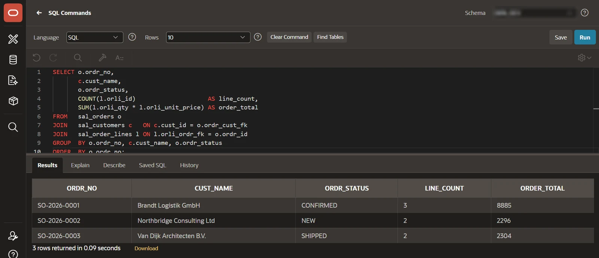<br>
  <em>Figure 1 · The demo orders, relational view. Three orders with 3, 2 and 2 lines — totals 8,885, 2,296 and 2,304.</em>
</p>

<a id="s3"></a>

## 6. Step 3: Create the Duality View

This is the heart of the post. The view describes the document's shape *and* which tables may be changed through it:

```sql
CREATE OR REPLACE JSON RELATIONAL DUALITY VIEW sal_order_dv AS
SELECT JSON {
  '_id'       : o.ordr_id,
  'orderNo'   : o.ordr_no,
  'orderDate' : o.ordr_date,
  'status'    : o.ordr_status,
  'note'      : o.ordr_note,
  'customer'  : (SELECT JSON {
                   'customerId' : c.cust_id,
                   'code'       : c.cust_code,
                   'name'       : c.cust_name,
                   'email'      : c.cust_email,
                   'city'       : c.cust_city,
                   'country'    : c.cust_country
                 }
                 FROM sal_customers c WITH NOINSERT NOUPDATE NODELETE
                 WHERE c.cust_id = o.ordr_cust_fk),
  'lines'     : [ SELECT JSON {
                    'lineId'    : l.orli_id,
                    'quantity'  : l.orli_qty,
                    'unitPrice' : l.orli_unit_price,
                    'product'   : (SELECT JSON {
                                     'productId' : p.prod_id,
                                     'sku'       : p.prod_sku,
                                     'name'      : p.prod_name,
                                     'category'  : p.prod_category
                                   }
                                   FROM sal_products p WITH NOINSERT NOUPDATE NODELETE
                                   WHERE p.prod_id = l.orli_prod_fk)
                  }
                  FROM sal_order_lines l WITH INSERT UPDATE DELETE
                  WHERE l.orli_ordr_fk = o.ordr_id ]
}
FROM sal_orders o WITH INSERT UPDATE DELETE;
```

| Part | Meaning |
|---|---|
| `'_id' : o.ordr_id` | Every document needs an `_id`; it maps to the root table's primary key. |
| `SELECT JSON { … }` | A JSON **object** — each `'name' : column` pair is one field. |
| `'customer' : (SELECT JSON …)` | A **nested object**: one customer per order, joined through the foreign key. |
| `'lines' : [ SELECT JSON … ]` | Square brackets make a JSON **array** — all lines of the order. |
| `WITH INSERT UPDATE DELETE` | Rows of this table may be created, changed and removed through the document. |
| `WITH NOINSERT NOUPDATE NODELETE` | **Read-only** inside this document. |

```sql
SELECT JSON_SERIALIZE(d.data PRETTY) AS order_document
FROM   sal_order_dv d
WHERE  d.data."orderNo" = 'SO-2026-0001';
```

<p align="center">
  <br>
  <em>Figure 2 · One order = one JSON document. Header, nested customer, a lines array with a product in each line — and a _metadata object with an etag that Oracle adds by itself.</em>
</p>

<a id="s4"></a>

## 7. Step 4: Prove the "Duality"

Before adding ORDS, three SQL tests prove that the tables and the documents really are the same data.

### Test A — change a table, the document changes

```sql
UPDATE sal_customers SET cust_city = 'Bremen' WHERE cust_code = 'C-1001';
-- re-run the SELECT from Step 3
```

<p align="center">
  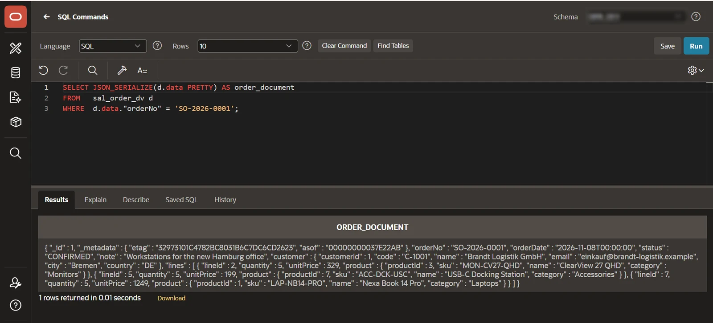<br>
  <em>Figure 3 · The document reflects the table change. "city" : "Bremen" — and the etag changed from CB5CD218… to 32973101…, because the document's content changed.</em>
</p>

Set the city back to `Hamburg` and the etag returns to `CB5CD218…`: the etag is calculated from the *content*, not from a counter.

### Test B — change the document, the table changes

```sql
UPDATE sal_order_dv d
SET    d.data = JSON_TRANSFORM(d.data, SET '$.status' = 'CONFIRMED')
WHERE  d.data."orderNo" = 'SO-2026-0002';

SELECT ordr_no, ordr_status FROM sal_orders WHERE ordr_no = 'SO-2026-0002';
```

<p align="center">
  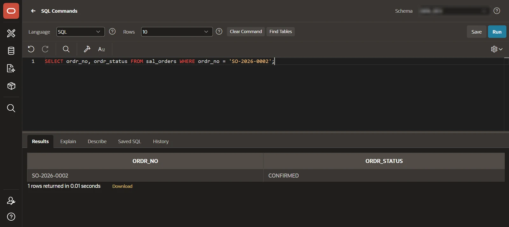<br>
  <em>Figure 4 · JSON in, relational row out. The order was NEW; after editing the JSON document, the plain table shows CONFIRMED.</em>
</p>

### Test C — the read-only rule is enforced

```sql
UPDATE sal_order_dv d
SET    d.data = JSON_TRANSFORM(d.data, SET '$.customer.name' = 'Brandt GmbH')
WHERE  d.data."orderNo" = 'SO-2026-0001';
```

<p align="center">
  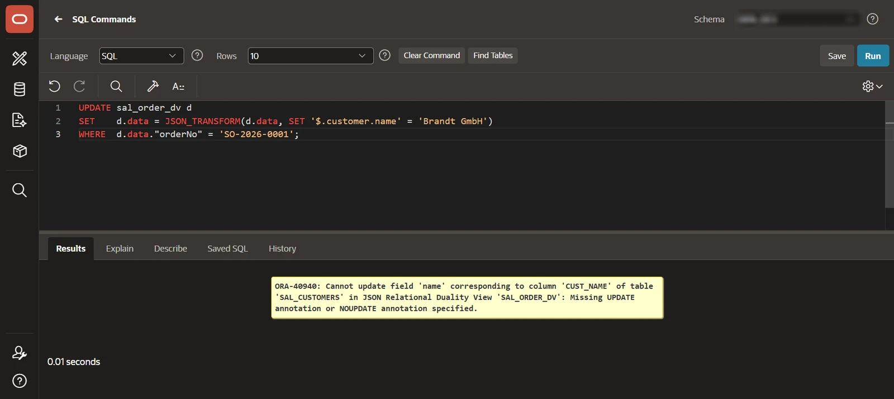<br>
  <em>Figure 5 · An order can't rename a customer. ORA-40940 names the field, the column, the table and the reason: SAL_CUSTOMERS is NOUPDATE in this view.</em>
</p>

> ✅ **Three tests, one conclusion:** one copy of the data, two ways to work with it — and the rules about what an order may change live in the database, not in your code.

<a id="s5"></a>

## 8. Step 5: Publish It with ORDS — One Call

The schema must be REST-enabled once. Mine already was; if yours isn't:

```sql
BEGIN
  ORDS.ENABLE_SCHEMA(
    p_enabled             => TRUE,
    p_schema              => 'YOUR_SCHEMA',
    p_url_mapping_type    => 'BASE_PATH',
    p_url_mapping_pattern => 'your_schema',
    p_auto_rest_auth      => FALSE);
  COMMIT;
END;
/
```

Then one call publishes the Duality View as a REST resource:

```sql
BEGIN
  ORDS.ENABLE_OBJECT(
    p_enabled        => TRUE,
    p_schema         => 'YOUR_SCHEMA',
    p_object         => 'SAL_ORDER_DV',
    p_object_type    => 'VIEW',
    p_object_alias   => 'orders',
    p_auto_rest_auth => FALSE);   -- dev only: see the Production Checklist
  COMMIT;
END;
/
```

> ℹ️ **No module, no templates, no handlers.** This is *AutoREST*: in **SQL Workshop → RESTful Services** the view appears under **Enabled Objects**, not under *Modules*. ORDS generates every endpoint from the view.

| Method | URL | What it does |
|---|---|---|
| **GET** | `/ords/your_schema/orders/` | All orders as documents (paged) |
| **GET** | `/ords/your_schema/orders/{_id}` | One order document |
| **POST** | `/ords/your_schema/orders/` | Create an order with its lines |
| **PUT** | `/ords/your_schema/orders/{_id}` | Replace the document — header and lines |
| **DELETE** | `/ords/your_schema/orders/{_id}` | Delete the order and its lines |

<p align="center">
  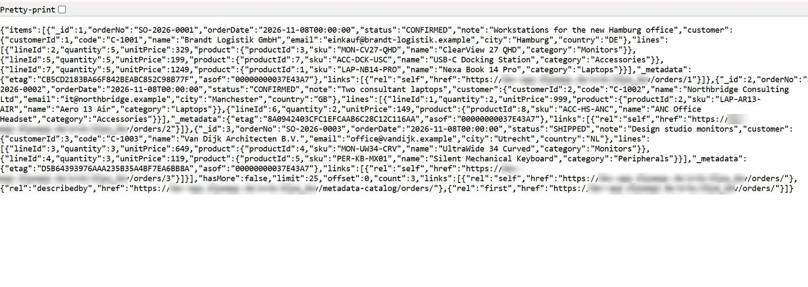<br>
  <em>Figure 6 · GET /orders/ in the browser. All three documents in an items array, with paging (hasMore, limit, offset, count) and navigation links.</em>
</p>

<p align="center">
  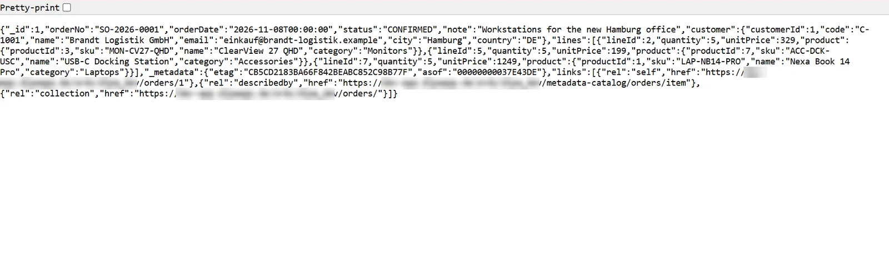<br>
  <em>Figure 7 · GET /orders/1. One order — the same document SQL returned, plus self, describedby and collection links.</em>
</p>

<a id="s6"></a>

## 9. Step 6: POST a Complete Order

**POST** `https://your-server/ords/your_schema/orders/` — Postman, **Body → raw → JSON**:

```json
{
  "orderNo": "SO-2026-0004",
  "orderDate": "2026-11-08T00:00:00",
  "status": "NEW",
  "note": "Medical workstations - created via REST",
  "customer": { "customerId": 4 },
  "lines": [
    { "quantity": 4, "unitPrice": 1249, "product": { "productId": 1 } },
    { "quantity": 4, "unitPrice": 59.9, "product": { "productId": 6 } }
  ]
}
```

Notice what's *not* in the body: no `_id`, no `lineId` (identity columns generate them), and no customer or product names — just their IDs.

<p align="center">
  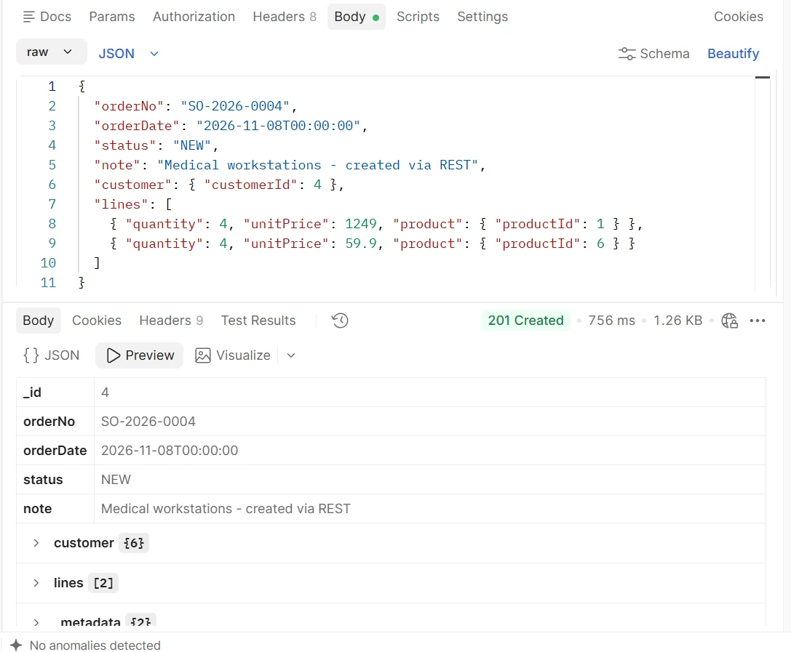<br>
  <em>Figure 8 · POST → 201 Created. A new _id of 4, generated line IDs, and the customer object filled in with all six fields from SAL_CUSTOMERS.</em>
</p>

One JSON request became **three inserts across two tables**, with every foreign key set correctly.

> 💡 **Postman tip:** choosing **raw → JSON** adds the `Content-Type: application/json` header automatically — it's in the hidden headers. With *Text* selected, ORDS would reject the request.

<a id="s7"></a>

## 10. Step 7: PUT — Update, Delete and Insert Lines in One Call

The real test. First **GET** `/orders/4` and copy the response. Then send it back with **PUT** to the same URL, with three changes to the lines:

| Change in the document | What Oracle does |
|---|---|
| Line 8 (Ergo Vertical Mouse) removed | **DELETE** from `SAL_ORDER_LINES` |
| Line 9 (Nexa Book 14 Pro): quantity 4 → 6 | **UPDATE** that row |
| New line with product 8, no `lineId` | **INSERT** a new row |

```json
{
  "_id": 4,
  "orderNo": "SO-2026-0004",
  "orderDate": "2026-11-08T00:00:00",
  "status": "NEW",
  "note": "Medical workstations - created via REST",
  "customer": {
    "customerId": 4, "code": "C-1004", "name": "Alpine Medical AG",
    "email": "procurement@alpinemedical.example", "city": "Innsbruck", "country": "AT"
  },
  "lines": [
    {
      "lineId": 9, "quantity": 6, "unitPrice": 1249,
      "product": { "productId": 1, "sku": "LAP-NB14-PRO", "name": "Nexa Book 14 Pro", "category": "Laptops" }
    },
    { "quantity": 4, "unitPrice": 149, "product": { "productId": 8 } }
  ],
  "_metadata": { "etag": "253926BBFE86BCE29D2827E12C04566C", "asof": "00000000037E57CB" }
}
```

> ⚠️ **Before you PUT:** remove the `"links"` block (it's ORDS navigation, not part of the order) and **keep `_metadata`** — its etag is what protects the update in Step 8.

<p align="center">
  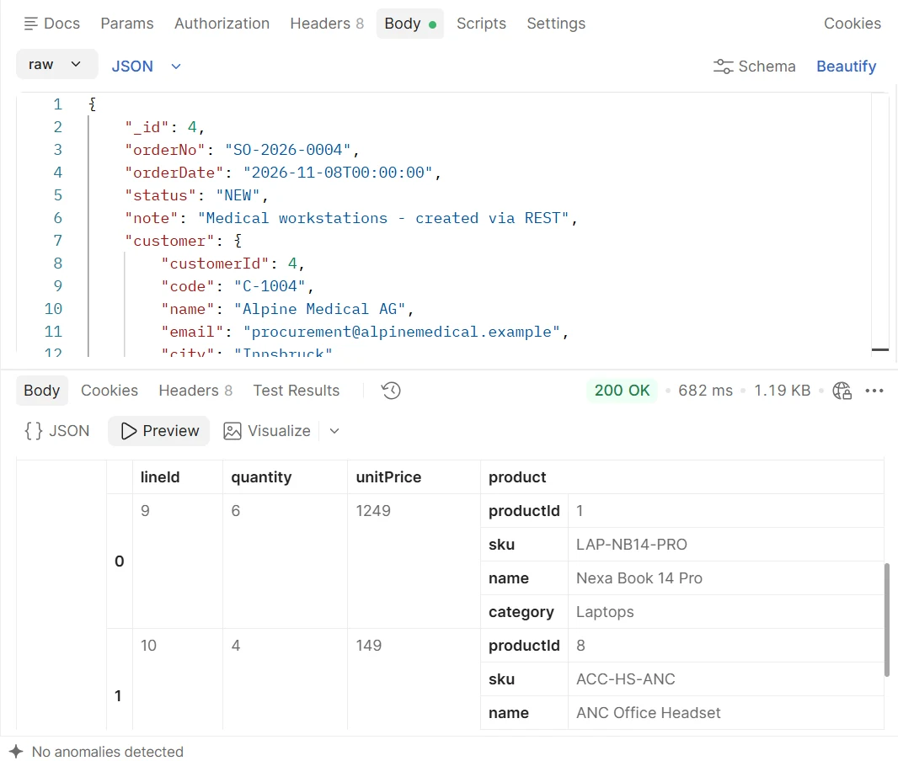<br>
  <em>Figure 9 · PUT → 200 OK. Line 9 now has quantity 6; the new line 10 came back as ANC Office Headset — we only sent productId: 8.</em>
</p>

<p align="center">
  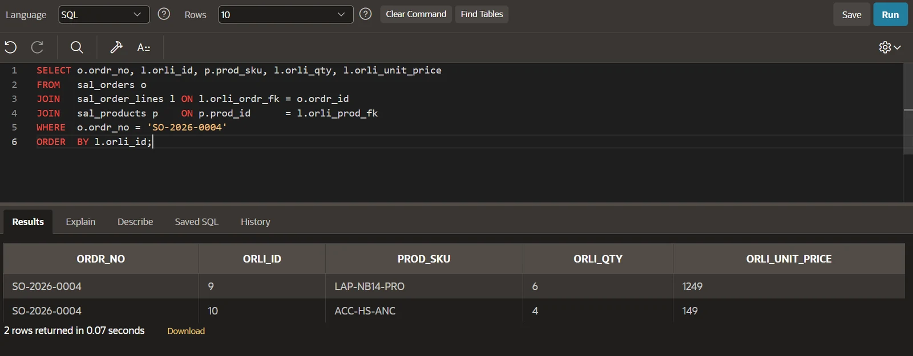<br>
  <em>Figure 10 · The tables after one PUT. Row 9 updated, row 10 inserted, row 8 deleted.</em>
</p>

> ✅ **One PUT, three different DML operations** — and Oracle decided which was which by comparing the document with the table. This is exactly the code you'd otherwise write by hand.

<a id="s8"></a>

## 11. Step 8: ETag — Lost-Update Protection for Free

Two people open order 4. User A confirms it; User B — still looking at the old version — changes the note and saves. Without protection, B silently overwrites A. The etag from `_metadata` prevents that.

| Step | Request | Result |
|---|---|---|
| 1 | Both users GET order 4 → same etag (*ETAG-1*) | — |
| 2 | User A: PUT with `status: CONFIRMED` and ETAG-1 | **200 OK**, new etag |
| 3 | User B: PUT with a new note, old status and ETAG-1 | **412 Precondition Failed** |
| 4 | GET order 4 | A's change is there, B's stale save is not |

<p align="center">
  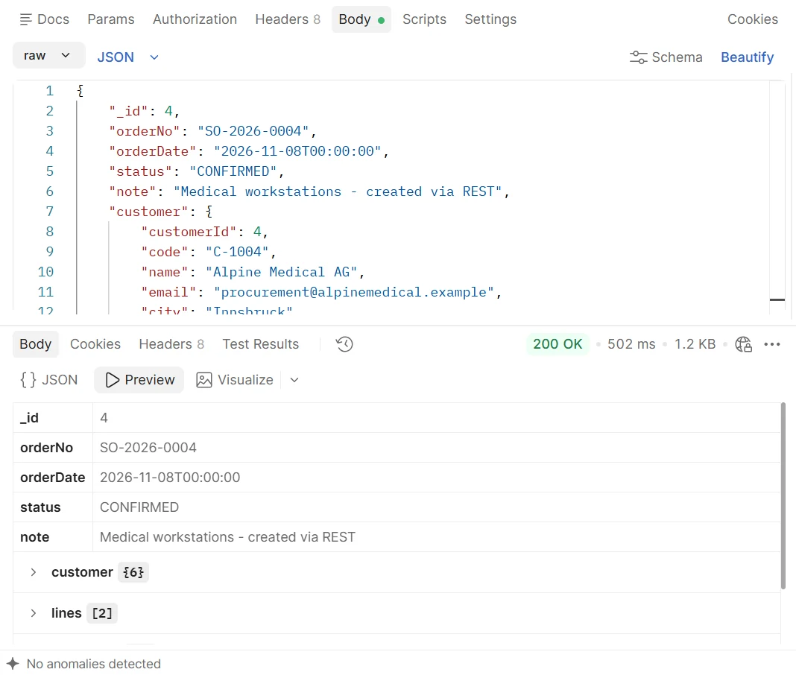<br>
  <em>Figure 11 · User A — current etag → 200 OK. Status changed to CONFIRMED; the order now has a new etag.</em>
</p>

<p align="center">
  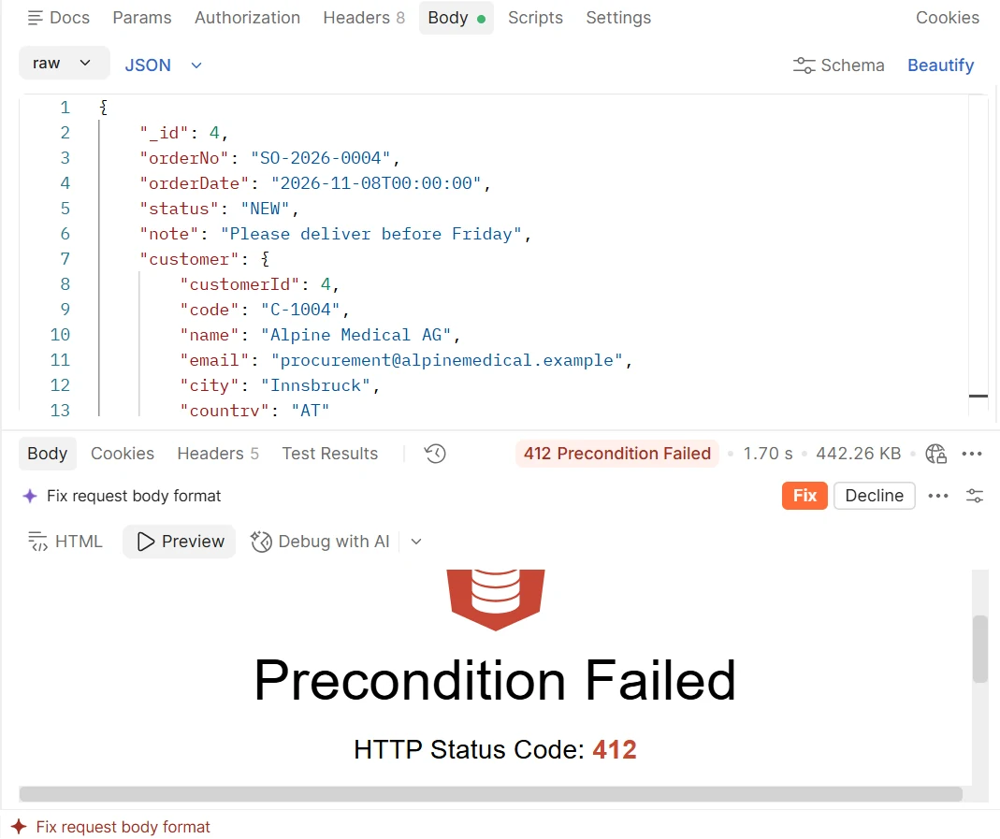<br>
  <em>Figure 12 · User B — stale etag → 412. ORDS rejects the update: the document changed since User B read it.</em>
</p>

<p align="center">
  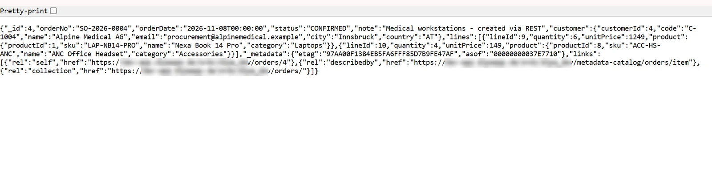<br>
  <em>Figure 13 · Nothing was lost. Status is still CONFIRMED, the note is unchanged, and the etag is the new one (97AA00F1…).</em>
</p>

**412** is the standard HTTP code for "your version is out of date". A client should react by reading the latest document, showing it to the user and letting them try again. No version column, no `SELECT … FOR UPDATE`, no locking code — the etag comes with the Duality View.

<a id="s9"></a>

## 12. Step 9: DELETE the Order

**DELETE** `https://your-server/ords/your_schema/orders/4` — no body.

<p align="center">
  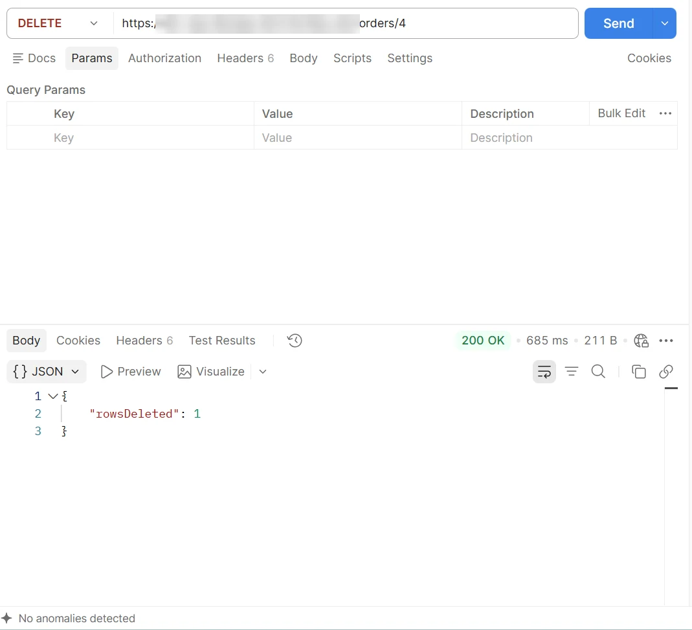<br>
  <em>Figure 14 · DELETE → 200 OK. {"rowsDeleted": 1}</em>
</p>

```sql
SELECT 'orders' AS tbl, COUNT(*) AS cnt FROM sal_orders      WHERE ordr_no = 'SO-2026-0004'
UNION ALL
SELECT 'lines',         COUNT(*)        FROM sal_order_lines WHERE orli_ordr_fk = 4;
```

<p align="center">
  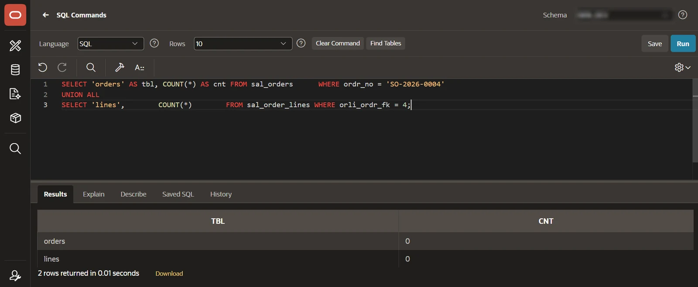<br>
  <em>Figure 15 · Order and lines gone. 0 and 0 — the header and both lines were deleted together. The customer and products are untouched, because they're read-only in this view.</em>
</p>

<p align="center">
  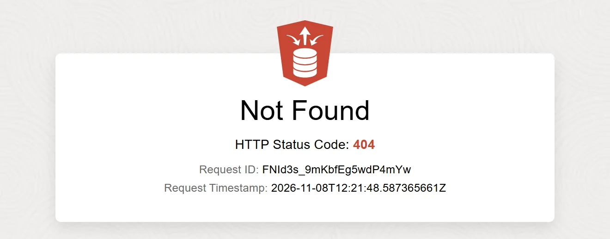<br>
  <em>Figure 16 · GET /orders/4 after the delete. ORDS answers 404 Not Found.</em>
</p>

<a id="gotchas"></a>

## 13. Gotchas That Cost Me Time

| Gotcha | What to know |
|---|---|
| 🔗 **`/r/` in the URL** | `/ords/r/…` is the path for *APEX applications* and gives "Application not found". REST URLs are `/ords/your_schema/orders/` — no `/r/`. |
| 🧩 **"Where's my module?"** | AutoREST objects appear under **Enabled Objects**, not *Modules*. There are no handlers to look for. |
| 📋 **Dictionary column names** | Columns of `USER_ORDS_ENABLED_OBJECTS` differ between ORDS versions — use `SELECT *` instead of guessing names. |
| 🔢 **Line order isn't guaranteed** | In my GET the mouse was line 8 and came *first*. Always identify lines by `lineId`, never by position in the array. |
| 🧹 **Remove `links`, keep `_metadata`** | Send the GET result back without `links`, but with `_metadata.etag`. |
| 🏷️ **Content-based etag** | Undoing a change gives the old etag back. Don't treat it as a version number. |
| 📄 **The 412 body is HTML** | ORDS returns its standard error page with no ORA- text. Check the **status code**, not the body. |

<a id="checklist"></a>

## 14. Production Checklist

| ✔ | Practice | Why |
|---|---|---|
| 🔒 | **Set `p_auto_rest_auth => TRUE`** and protect it with OAuth (step by step in my [ORDS CRUD post](https://apexwithhassaan.vercel.app/blog/ords-crud-rest-api#security)) | With `FALSE`, anyone who knows the URL can read and change orders |
| 🛡️ | **Mark reference data read-only** — `NOINSERT NOUPDATE NODELETE` | A document should only change what it owns |
| 🔁 | **Always send the etag** on PUT and handle `412` in the client | Lost-update protection only works if the client takes part |
| ✅ | **Keep CHECK, NOT NULL and FK constraints** on the tables | They still validate every document written through the view |
| 🗂️ | **Index every foreign key** used by the view | Each document read joins on them |
| 🧭 | **Expose only the fields clients need** | The view *is* your API contract — columns you leave out stay private |
| 📄 | **Use paging** (`limit` / `offset`) for collections | GET `/orders/` returns 25 documents by default |
| 🔐 | **HTTPS everywhere** | Orders contain customer data |

<a id="wrap"></a>

## 15. Wrap-Up

With one view and one ORDS call we built a complete order API:

- A **JSON-Relational Duality View** that turns four tables into one order document.
- **Two-way updates**: change a table and the document changes; change the document and the tables change.
- **Rules in the database**: an order can't rename a customer (`ORA-40940`).
- **AutoREST** with GET, POST, PUT and DELETE — no module, no handlers.
- One **PUT** doing an update, a delete and an insert, and **ETag** protection returning `412` for stale saves.

Compare it with the five hand-written handlers from the [CRUD post](https://apexwithhassaan.vercel.app/blog/ords-crud-rest-api) and you'll see why Duality Views are one of the most important features of Oracle 23ai for anyone building APIs on Oracle data.

---

## 📝 Changelog

See [CHANGELOG.md](CHANGELOG.md) for the version history.

---

## 📄 License

Released under the [MIT License](LICENSE) — free to use, modify and redistribute in personal and commercial projects.

---

## 🙏 Credits

Built by **Hassaan Ahmed Tahir** — Senior Oracle APEX Developer.
Special thanks to **Sajjad Hanifa** for his continued guidance and support in exploring and refining these Oracle APEX techniques.

📌 Read the original write-up on **[APEX with Hassaan](https://apexwithhassaan.vercel.app/blog/duality-views-ords)**, and keep an eye on the blog for more Oracle APEX tutorials.
